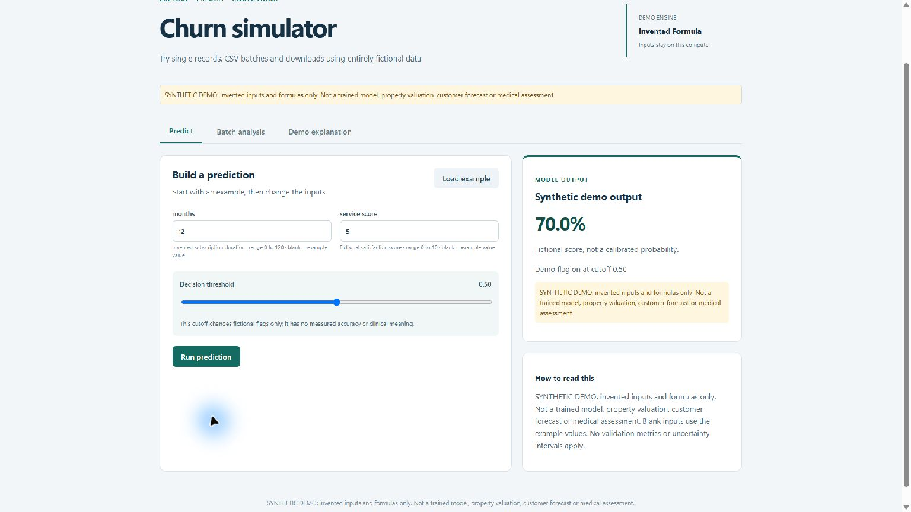
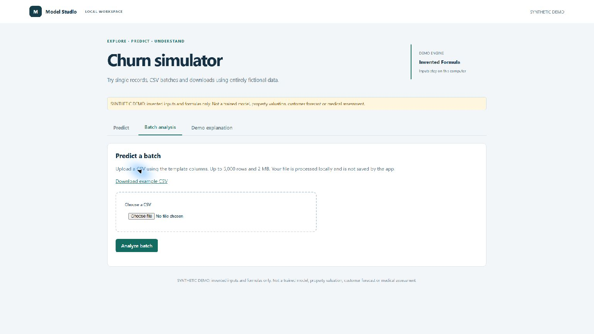

# Customer Churn Prediction

Explore churn classification, calibrated probabilities, decision thresholds, and retention scenarios with explicit cost assumptions.

[Quick demo](DEMO.md) ? [Study findings](CHURN_IMPROVEMENT_FINDINGS.md) ? [Model card](MODEL_CARD.md) ? [Reproduce](GITHUB_PREPARATION.md) ? [CI](https://github.com/shrutikbalwan/customer-churn-prediction/actions)



*Actual app screenshot using invented formulas. Demo outputs are not trained-model predictions.*

## Quick start

Python **3.13** is the tested version. From this repository folder on Windows:

```powershell
py -3.13 -m venv .venv
.\.venv\Scripts\python.exe -m pip install -r requirements-runtime.txt
.\.venv\Scripts\python.exe -m ml_projects.app --demo --port 8502
```

Open **http://127.0.0.1:8502** and look for **SYNTHETIC DEMO**. Stop with Ctrl+C.
On macOS/Linux, use `python3.13` and `.venv/bin/python`.
Demo mode needs no account, API key, original workbook or trained model.
Follow the [illustrated walkthrough](docs/WALKTHROUGH.md).

## Features

- Separate fitting, calibration and threshold-selection partitions.
- Nested evaluation of engineered features and model alternatives.
- Retention scenario analysis with explicit, unmeasured intervention assumptions.
- Single-record prediction, CSV batches and downloadable results.
- Input validation, same-origin checks and a 5,000-row / 2 MB request limit.
- An explicit fictional demo that never loads or modifies trained artifacts.

| Mode | Requirements | Output |
|---|---|---|
| `--demo` | Runtime dependencies only | Invented formula values marked as synthetic |
| Default trained mode | Authorized data and regenerated model artifacts | Saved model predictions and historical evidence |

The demo is an interface simulator, not a model trained on synthetic data.
Missing trained artifacts cause an explicit error; there is no silent fallback.

## Historical model results

| Metric | Value |
|---|---:|
| ROC-AUC | 0.8422 |
| Recall | 78.88% |
| F1 | 0.6120 |
| Brier score | 0.1381 |

The original test set was inspected during earlier development. These are
**historical benchmark results**, not fresh external validation. They describe
the separate trained pipeline, not the fictional demo.

A churn score does not establish causality or the effectiveness of an intervention. The engineered challenger did not meet the predefined promotion criterion, so the existing model was retained. Unfamiliar categories use the fitted fallback and may yield less reliable predictions.

See [the study findings](CHURN_IMPROVEMENT_FINDINGS.md) and [MODEL_CARD.md](MODEL_CARD.md)
for methodology, intended use and limitations.

## Screenshots

| Single record | CSV batch workflow |
|---|---|
|  |  |

All screenshots use fictional demo data. [Walkthrough and presentation script](docs/WALKTHROUGH.md).

## Architecture

```text
Browser: index.html + app.js + demo.js
                  |
         loopback HTTP JSON / CSV
                  |
        ml_projects/app.py
           /             \
  explicit --demo     default trained mode
      demo.py           advanced.py
  invented formulas   saved sklearn pipeline
```

Training and evaluation studies are separate CLI workflows. The browser cannot
trigger training. Submitted inputs are processed locally and not saved by the
server. This educational app is not a production multi-user service.

## Reproduce the trained project

Follow [GITHUB_PREPARATION.md](GITHUB_PREPARATION.md) for dependency installation,
authorized workbook placement and the full training order. The study entry point
is `python -m ml_projects.churn_study`, after generating the baseline and advanced
artifacts as documented there.

Original data, model binaries, row-level outputs, executed notebooks and generated
HTML reports are excluded from Git. A fresh clone provides the source to
regenerate them. Interactive notebooks additionally need
`requirements-notebook.txt`; regenerate notebooks before opening them.

## Tests

```powershell
.\.venv\Scripts\python.exe -m pip install -r requirements-dev.txt
.\.venv\Scripts\python.exe -m pytest tests/test_public_smoke.py tests/test_demo.py -q
```

The **12 dataset-free tests** run in GitHub Actions on Windows and Ubuntu with
Python 3.13. [The demo implementation CI run passed](https://github.com/shrutikbalwan/customer-churn-prediction/actions/runs/45939423999);
check the latest Actions run for subsequent commits.

The full local suite passed **32 tests** with authorized data and generated
artifacts. Two known warnings occurred in the unfamiliar-category edge-case test.
After reproduction, run `python -m pytest -q` for the full suite. CI smoke checks
do not validate real-world model accuracy.

## Data and licensing

See [DATASET.md](DATASET.md) for provenance and the unconfirmed redistribution
permission. Original workbooks are not uploaded. No code license has been selected;
this repository does not currently grant an explicit open-source license.
